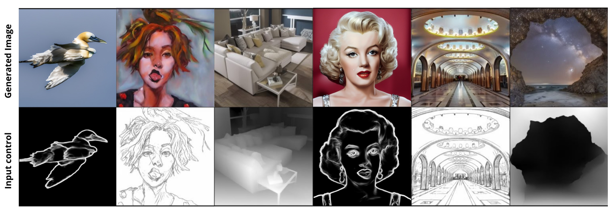
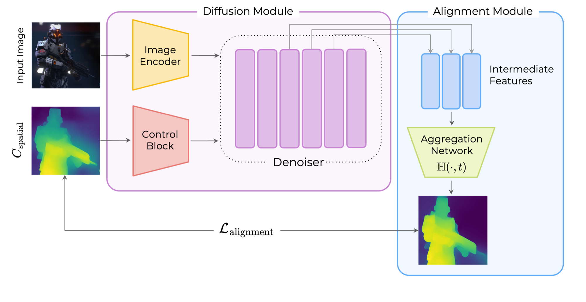
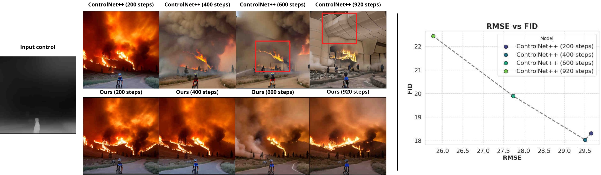
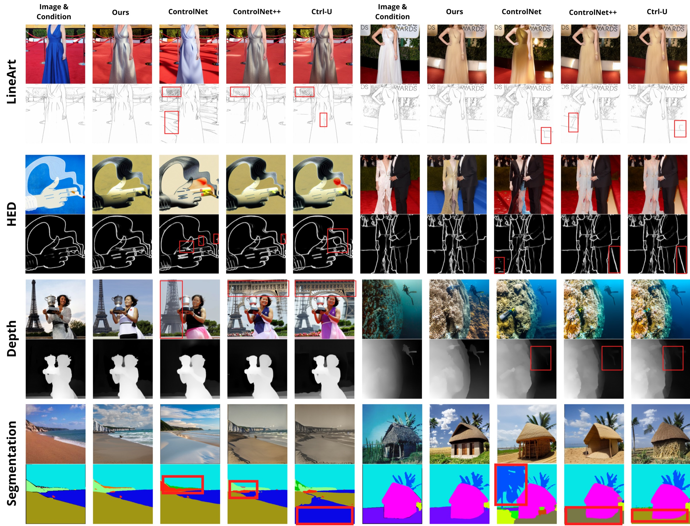
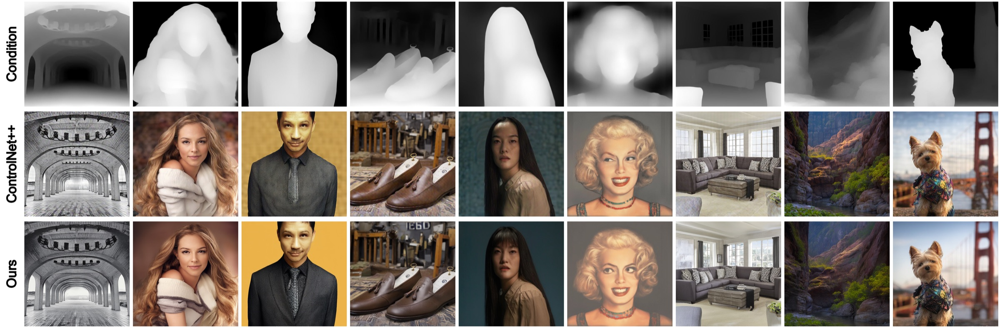

# InnerControl: Aligning ControlNet with Internal Feature Feedback

**WACV 2027**

[Nina Konovalova](https://scholar.google.com/citations?user=lD5JnEAAAAAJ)<sup>1\*</sup>,
Ibragim Idrisov<sup>2\*</sup>,
Kamil Garifullin<sup>3,4</sup>,
Timofei Sobornov<sup>3</sup>,
[Aibek Alanov](https://scholar.google.com/citations?user=MXJTRGoAAAAJ)<sup>3,4</sup>

<sup>1</sup>MBZUAI &nbsp; <sup>2</sup>Lomonosov Moscow State University &nbsp; <sup>3</sup>HSE University &nbsp; <sup>4</sup>FusionBrain Lab
<br><sup>\*</sup>Equal contribution

<a href="https://arxiv.org/abs/2507.02321"></a>
<a href="https://controlgenai.github.io/InnerControl/"></a>
<a href="./LICENSE.txt"></a>

<p align="center">
  
</p>

> ControlNet++ applies its reward loss only on the last 200 denoising steps: at noisier steps the one-step image prediction is too blurry for an image-space reward model, and extending the reward causes artifacts. InnerControl trains small probes that read the control signal (depth, edges, segmentation) **directly from intermediate diffusion features**, and uses them as an alignment loss across most of the denoising trajectory.

## Abstract

Despite significant progress in text-to-image diffusion models, achieving precise spatial control over generated outputs remains challenging. One of the popular approaches for this task is ControlNet, which introduces an auxiliary conditioning module into the architecture. To improve alignment of the generation image and control, ControlNet++ proposes a cycle consistency loss to refine correspondence between controls and outputs, but restricts its application to the final denoising steps, while the main structure is introduced at an early stage of generation. To address this issue, we suggest **InnerControl** — a training strategy that enforces spatial consistency across all diffusion steps. Specifically, we train lightweight control prediction probes — small convolutional networks — to reconstruct input control signals (e.g., edges, depth) from intermediate diffusion features at every denoising step. We prove the efficiency of such models to extract signals even from very noisy latents and utilize these models to generate pseudo ground truth controls during training. Suggested approach enables alignment loss that minimizes the difference between predicted and target condition throughout the whole diffusion process. Our experiments demonstrate that our method improves control alignment and fidelity of generation. Our approach can be applied to both UNet- and Transformer-based diffusion architectures and be integrated with established training techniques (e.g., ControlNet++) to achieve high performance across different condition methods such as edge, segmentation and depth conditions.

## Method

<p align="center">
  
</p>

A lightweight, timestep-conditioned probe $\mathbb{H}(\cdot, t)$ aggregates intermediate denoiser features (UNet decoder features or Transformer block features) and predicts the spatial control. The alignment loss compares this prediction with the input control $c_{\text{spatial}}$ at every sampled timestep:

$$\mathcal{L}_{\text{training}} = \mathcal{L}_{\text{diffusion}} + \alpha \cdot \mathcal{L}_{\text{reward}} + \beta \cdot \mathcal{L}_{\text{alignment}}$$

The reward loss (ControlNet++) stays on the late, low-noise steps where one-step predictions are sharp; the alignment loss covers the early steps where spatial structure is formed. Extending the reward loss alone to early steps lowers RMSE but introduces visible artifacts and a higher FID:

<p align="center">
  
</p>

## Results

<p align="center">
  
</p>

LineArt, HED, depth and segmentation control on SD1.5, compared with ControlNet, ControlNet++ and Ctrl-U. Under each generated image is the control extracted from it; red boxes mark misalignments with the input condition.

<p align="center">
  
</p>

Depth control on FLUX.1: input condition, ControlNet++ and InnerControl.

Quantitative results for SD1.5, SDXL, SD3.5 and FLUX.1, ablations and user studies are in the paper and on the [project page](https://controlgenai.github.io/InnerControl/).

## Environment

```bash
git clone <this-repository-url> InnerControl
cd InnerControl
pip3 install -r requirements.txt
pip3 install clean-fid torchmetrics
```

## Data preparation

All data is hosted on Hugging Face and is downloaded automatically during training or evaluation. You can preview the samples and disk usage in advance:

| Task | Training data 🤗 | Evaluation data 🤗 |
|:--:|:--|:--|
| LineArt, HED | [MultiGen-20M_train](https://huggingface.co/datasets/limingcv/MultiGen-20M_train), 1.14 TB | [MultiGen-20M_canny_eval](https://huggingface.co/datasets/limingcv/MultiGen-20M_canny_eval), 2.25 GB |
| Depth | [MultiGen-20M_depth](https://huggingface.co/datasets/limingcv/MultiGen-20M_depth), 1.22 TB | [MultiGen-20M_depth_eval](https://huggingface.co/datasets/limingcv/MultiGen-20M_depth_eval), 2.17 GB |

## Training

The paper runs were trained on 8 H100 GPUs (about 6 hours per run); the scripts use 8 processes with batch size 8 × gradient accumulation 4 = effective batch 256. Change the number of GPUs in [`train/config.yml`](train/config.yml); with fewer GPUs, lower the batch size and increase gradient accumulation.

The alignment loss needs a pretrained alignment probe for each task. The scripts expect it at `checkpoints/aligning/{depth,hed,lineart}.pt` (`--readout_path`). **Probe checkpoints are not released yet.** The probe architecture is in [`train/aggregation_network.py`](train/aggregation_network.py) and follows [Readout Guidance](https://github.com/google-research/readout_guidance).

The paper trains in two stages of 10k iterations each: the public ControlNet is first fine-tuned with the standard diffusion loss, then training continues with reward + alignment loss. For depth, stage 1 is [`train/depth_tuning.sh`](train/depth_tuning.sh); set `CONTROLNET_DIR` in the `aligned_*.sh` script to its output. As shipped, the `aligned_*.sh` scripts start from the public `lllyasviel/control_v11*` ControlNets.

```bash
bash train/depth_tuning.sh      # stage 1 (depth)
bash train/aligned_depth.sh     # stage 2
bash train/aligned_hed.sh
bash train/aligned_linedrawing.sh
```

Main arguments of [`train/reward_control_aligned.py`](train/reward_control_aligned.py):

| Argument | Meaning |
|:--|:--|
| `--min_timestep_rewarding`, `--max_timestep_rewarding` | timestep range of the reward loss |
| `--min_timestep_readout`, `--max_timestep_readout` | timestep range of the alignment loss |
| `--grad_scale` | reward-loss weight $\alpha$ |
| `--aligning_alpha` | alignment-loss weight $\beta$ |
| `--readout_path` | alignment probe checkpoint |

Settings used in the paper (already set in the scripts):

| Task | Reward weight $\alpha$ | Reward steps | Alignment weight $\beta$ | Alignment steps |
|:--|:--:|:--:|:--:|:--:|
| Depth | 0.5 | [0, 400] | 1.0 | [0, 920] |
| HED | 1.0 | [0, 400] | 0.1 | [0, 800] |
| LineArt | 10.0 | [0, 200] | 2.0 | [0, 700] |

The final ControlNet is saved to `OUTPUT_DIR` and its EMA copy to `OUTPUT_DIR_ema`.

## Evaluation

Set `CONTROLNET_DIR` in each script to your trained ControlNet (by default the EMA output of the matching training script), then run:

```bash
bash eval/eval_depth.sh     # RMSE
bash eval/eval_hed.sh       # SSIM
bash eval/eval_lineart.sh   # SSIM
```

CLIP score and FID of the images generated by `eval/eval_depth.sh` (keep `CONTROLNET_DIR`, `SCALE` and `NUM_STEPS` in sync; for FID, first save the evaluation-set images as `<idx>.png` into `REAL_IMAGE_DIR`):

```bash
bash eval/eval_clip.sh
bash eval/eval_fid.sh
```

## Inference

[`inference.ipynb`](inference.ipynb) generates images with a trained SD1.5 ControlNet. Set `controlnet_path` to your checkpoint directory.

## Repository layout

```text
train/   training (reward + alignment loss), alignment probe, feature hooks
eval/    image generation for evaluation and metrics
mmlab/   MMSegmentation model configs
images/  figures for this README
```

## Acknowledgements

We thank the [Hugging Face](https://huggingface.co), [ControlNet](https://github.com/lllyasviel/ControlNet), [ControlNet++](https://github.com/liming-ai/ControlNet_Plus_Plus), [Readout Guidance](https://github.com/google-research/readout_guidance) and [Diffusion Hyperfeatures](https://github.com/diffusion-hyperfeatures/diffusion_hyperfeatures) communities for their open-source code.

## Citation

If our work assists your research, please cite:

```bibtex
@inproceedings{konovalova2027innercontrol,
  title     = {InnerControl: Aligning ControlNet with Internal Feature Feedback},
  author    = {Konovalova, Nina and Idrisov, Ibragim and Garifullin, Kamil and Sobornov, Timofei and Alanov, Aibek},
  booktitle = {Proceedings of the IEEE/CVF Winter Conference on Applications of Computer Vision (WACV)},
  year      = {2027}
}
```
